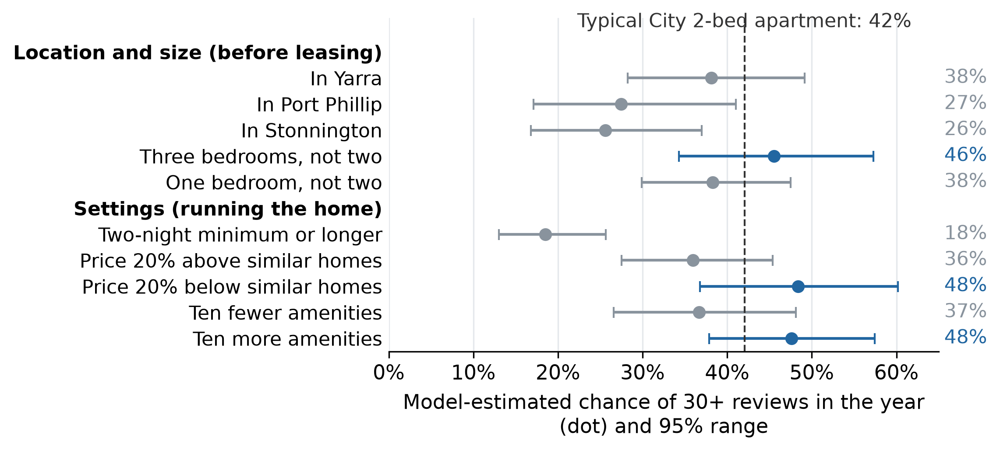
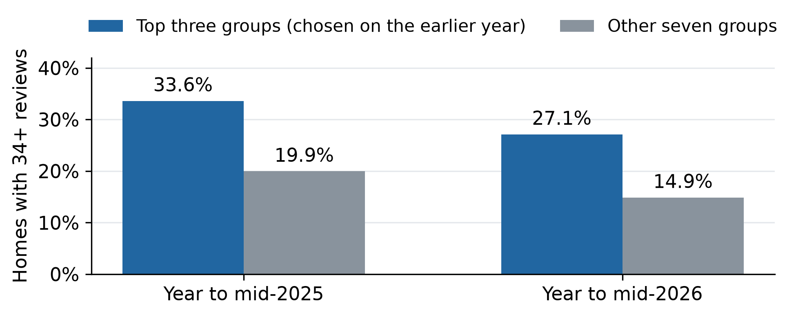
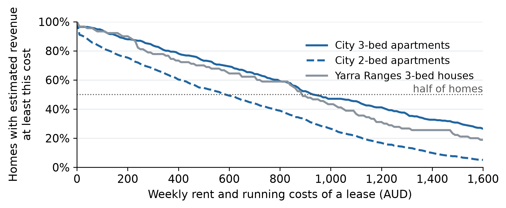

# Melbourne Airbnb Market Screening

CMCE30005 Final Project Report | Group 2 | Eric Huang and Maksym Xu

We help a rent-to-rent operator choose where to search and which homes to inspect. One Melbourne Airbnb snapshot identifies City two- and three-bedroom apartments as the first search priority, with Yarra Ranges three-bedroom houses as a less certain alternative. Within these groups, homes that accept one-night stays and are priced at or below similar homes were busy half the time (50.4%), as often as homes picked by our logistic model (49.6%) and well above random picking (32.4%).

**Final report (revised 23 October 2026):** [PDF](final-report/report-2026-10-04/Final_Report.pdf) · [Word](final-report/report-2026-10-04/Final_Report.docx) · [Markdown](final-report/report-2026-10-04/Final_Report.md) · [Report package and checks](final-report/report-2026-10-04/README.md)

After the report: [Repository guide](#repository-guide) · [How to reproduce the results](#how-to-reproduce-the-results) · [Contributions](#contributions)

<!-- final report starts here -->

## 1. Introduction

Our client plans to lease homes in Greater Melbourne for Airbnb short stays. Rent and setup costs come before guest income, so a poor lease ties up scarce startup funds.

We recommend City of Melbourne two- and three-bedroom apartments first, then Yarra Ranges three-bedroom houses and townhouses. These groups had the highest shares of homes with strong guest activity, and their typical homes earned an estimated AUD 30,600–48,600 a year before costs, against AUD 24,700 across the study.

Within these groups, homes that accepted one-night stays and were priced at or below similar homes were busy half the time (50.4%), against one in three at random (32.4%). Section 6 turns this into a search order, a checklist and a cost test.

## 2. Problem Definition and Objectives

The business question is: **where should a rent-to-rent operator with limited funds search, and which homes should it inspect first?** We set three objectives:

1. Rank property groups by their share of homes with strong guest activity, and express this in nights and revenue.
2. Identify which home settings go with strong activity, and test whether they pick better homes within the leading groups than random picking.
3. Turn the results into a search order and a four-week inspection plan.

Objective 1 needs only a simple summary by group (Section 5.2). Objective 2 needs a model, because a group summary gives every home in a group the same rate.

A **group** combines council area, dwelling type and bedroom count. A home is **busy** (reaches our target) when it receives at least 30 guest reviews in the year before data collection, a level reached by a quarter of separate reference homes (Section 3). Inside Airbnb (n.d.) assumes half of stays are reviewed and each lasts three nights (or the minimum stay if longer), capping estimated nights at 255 a year, so 30 reviews means about 180 booked nights.

**What review activity measures.** Guests review only after a stay, so reviews track completed bookings, a guide to demand and occupancy; this matters because empty nights are the operator's main risk. Reviews do not show profit (rents and costs are outside our data) or satisfaction (reviews can be negative), so we convert them into nights and revenue and check ratings (Section 5.1). We do not rank on revenue: Inside Airbnb estimates it from reviews and advertised prices, and without rents a higher price is not a better lease.

Since the interim report, we replaced its random forest with an explainable logistic regression.

## 3. Data Description and Preparation

We use one Inside Airbnb snapshot of Melbourne, supplied through the subject LMS and collected 17 June–1 July 2026 (Inside Airbnb, 2026). It holds 25,728 listings and 1,026,690 dated reviews. We did not use the calendar, which cannot separate bookings from blocked nights.

Cleaning converted prices to numbers, standardized missing entries, counted amenities and rebuilt annual review counts from review dates. Price is missing for 6,553 listings (25%) and bedrooms for 4,679 (18%); 4,477 listings (17%) have never been reviewed.

We keep homes priced AUD 30–1,500 that are entire rental units or condos (*apartments*) or entire homes or townhouses (*houses/townhouses*), with one to three bedrooms and a first review at least a year before collection, so each has a full year of reviews.

We set aside about one in five hosts (1,342 homes) to set an independent target: of their 906 homes in the final groups, a quarter received 30 or more reviews (Table 1).

**Table 1. From supplied listings to analysis sample**

| Step | Homes |
|---|---:|
| All listings | 25,728 |
| Entire homes with one to three bedrooms | 16,576 |
| Apartments, condos, houses and townhouses | 14,895 |
| Priced AUD 30–1,500 | 11,099 |
| First review at least a year before collection | 6,891 |
| After setting aside 1,342 reference-host homes | 5,549 |
| **Analysis sample: 14 groups with at least 50 homes** | **3,873** |

The 3,873 analysis homes belong to 1,726 hosts in six council areas, the only areas with groups of at least 50 homes. The price rule drops 3,796 residential listings: 77.8% had no review in the past year, against 17.0% of those kept.

## 4. Methodology

**Group comparison.** We compare the share of busy homes in the 14 groups; redrawing hosts at random 1,000 times shows how much each share could move by chance (middle 90% of results).

**Two-setting rule.** To test whether a simple summary does as well as the model, we split priority-group homes by one-night stays and by price at or below the group median.

**Model.** Logistic regression turns six inputs into a chance of being busy (R Core Team, 2026); its weights show how each input moves that chance with the others held fixed. Table 2 lists the outcome and inputs.

**Table 2. Outcome and inputs of the model**

| Variable | Definition |
|---|---|
| **Outcome** | 1 if the home had at least 30 reviews in the year, otherwise 0 |
| Council area | One of six |
| Dwelling type | Apartment, or house/townhouse |
| Bedrooms | One, two or three |
| Price compared with similar homes | Price relative to the group median, per 10% |
| Accepts one-night stays | Minimum stay of one night (yes or no) |
| Amenity count | Amenities listed, per ten |

We compare this **full model** with two simpler options. The **group rate** (a group's share of busy homes) scores all its homes equally, which within a group is **random picking**. The **reduced model** drops price and minimum stay to show what they add.

**Assumptions.** Homes of the same host can perform alike, so they stay together in every test. Each 10% price step and ten extra amenities have a fixed effect on the score; Appendix A checks overlap between inputs and curved relationships.

**Testing.** Each of 50 tests builds the model on 70% of hosts and scores the other 30%. In each priority group, each method picks a quarter of these homes, and we compare the share that were busy.

**Two-year check.** We rank groups on an earlier year and follow the top three into the next (Section 5.4).

## 5. Analysis and Results

### 5.1 Data exploration: most homes are quiet; busy homes accept one-night stays and are well rated

Guest activity is very uneven (Figure 1). The median home received 15 reviews, a quarter (981 homes, 25.3%) received 30 or more, and 334 homes (8.6%) received none.

**Figure 1.** Annual reviews per home, 3,873 analysis homes. Source of all figures and tables: Inside Airbnb (2026); Group 2 analysis.

**Table 3. Busy homes compared with the rest**

| Characteristic | Busy (30+ reviews) | Below 30 | All homes |
|---|---:|---:|---:|
| Homes | 981 | 2,892 | 3,873 |
| Median nightly price (AUD) | 254 | 266 | 262 |
| Accept one-night stays | 67.7% | 37.5% | 45.1% |
| In the City of Melbourne | 76.9% | 59.6% | 64.0% |
| Median estimated nights (cap 255) | 255 | 60 | 96 |
| Median estimated revenue (AUD a year) | 58,400 | 16,600 | 24,700 |
| Mean guest rating (out of 5 stars) | 4.84 | 4.69 | 4.73 |
| Rated below 4.5 stars | 1.1% | 15.2% | 11.6% |

Busy homes were slightly cheaper but far more often accepted one-night stays and sat in the City of Melbourne (Table 3); their revenue estimate is higher partly because it is calculated from reviews. They were also better rated: only 1.1% averaged below 4.5 stars, against 15.2% of the rest, a gap that holds in each priority group (Huang & Xu, 2026). High activity comes with satisfied guests, not complaints.

### 5.2 Descriptive comparison: a simple summary puts City apartments first

Group rates range from 8.2% to 36.6% against 25.3% overall, and the three priority groups lead (Figure 2, Table 4).

**Figure 2.** Share of busy homes in all 14 groups, with 90% ranges from redrawing hosts; priority groups in blue.

**Table 4. Priority groups: median estimated nights and annual revenue (AUD)**

| Group | Homes | Share busy | Nights, all homes | Revenue, all homes | Revenue rank | Revenue, below 30 |
|---|---:|---:|---:|---:|---:|---:|
| City 3-bed apartments | 306 | 36.6% | 126 | 48,600 | 1 | 32,100 |
| City 2-bed apartments | 1,235 | 32.8% | 108 | 30,600 | 5 | 16,600 |
| Yarra Ranges 3-bed houses | 90 | 30.0% | 120 | 46,100 | 2 | 31,100 |
| All 14 groups | 3,873 | 25.3% | 96 | 24,700 | – | 16,600 |

The same three groups lead without the price or review-history rule (Huang & Xu, 2026). The City groups stayed in the top three in 94% and 90% of 1,000 host redraws and Yarra Ranges houses in 64%, a less certain second option.

**When the rankings differ.** On median revenue (Table 4), Yarra Ranges houses rank second and City two-bedroom apartments fifth, mainly because the houses charge more a night (AUD 426 against 285). With rents unknown, activity guides the search; revenue tests each lease.

### 5.3 Predictive analysis: what goes with being busy, and does it help pick homes?

Holding other inputs fixed, three settings an operator controls go with busy homes (Figure 3; Table A1). A typical City two-bedroom apartment has a **42%** chance of being busy with one-night stays but **18%** with a two-night minimum or longer. Pricing 20% above similar homes lowers it to **36%**; ten more amenities raise it to **48%**. These are associations: changing a setting alone does not guarantee more bookings.

**Figure 3.** Model-estimated chance that a typical City two-bedroom apartment is busy when one input changes, with 95% ranges.

A simple two-setting rule captures most of this (Table 5): in the priority groups, homes that accepted one-night stays and were priced at or below their group median were busy **50.4%** of the time, and homes with neither **9.3%**.

**Table 5. Share of busy homes in the three priority groups, by two settings**

| Minimum stay | Price at or below group median | Price above group median |
|---|---:|---:|
| One night accepted | 50.4% (462 homes) | 36.1% (477 homes) |
| Two nights or more | 30.2% (358 homes) | 9.3% (334 homes) |

Tested on unseen hosts, the model's top quarter of each priority group was busy **49.6%** of the time, against **38.6%** for the reduced model and **32.4%** at random (Figure 4), winning 46 of 50 tests. The two-setting rule does about as well: it picks 28% of homes, and 50.4% of them were busy, though it was checked on the homes that suggested it. The model's value is in showing which settings matter; Table A2 gives its hits and misses.

**Figure 4.** Busy share of picked homes (a quarter of each priority group), averaged over 50 tests.

### 5.4 Over time: the leading groups stayed ahead

For 2,657 homes with two years of reviews in ten groups, the earlier year's top three were the same priority groups: 33.6% of their homes reached that year's reference level of 34 reviews, against 19.9% elsewhere (Figure 5). A year later they still led (**27.1% against 14.9%**) and remained the top three, although Yarra Ranges houses fell to 21.4%. With hosts weighted equally, the later-year lead is 8.7 points.

**Figure 5.** The same 2,657 homes in two consecutive years; target 34 reviews.

## 6. Key Findings and Recommendations

### Key findings

1. **Where:** City of Melbourne two- and three-bedroom apartments led on busy homes and above-median revenue, followed less certainly by Yarra Ranges three-bedroom houses; all three stayed ahead a year later (Figures 2 and 5, Table 4).
2. **What goes with high activity:** One-night stays and a price at or below similar homes. In the priority groups, 50.4% of homes with both were busy, against 9.3% with neither (Table 5, Figure 3), though part of the one-night effect is built into the review count. Busy homes were also better rated (Table 3).
3. **Which home first:** These two settings pick busy homes about as well as the model: one in two, against one in three at random (Figure 4).

### Recommendations

1. **Search City of Melbourne two- and three-bedroom apartments first, then Yarra Ranges three-bedroom houses** (Figure 2, Table 4). Between leases that pass, choose the larger cash-flow margin; if margins are similar, choose the group with the higher share of busy homes.
2. **Prefer homes that can take one-night stays at a price at or below similar listings** (Table 5, Figure 3). At inspection, check that building rules allow one-night stays and that this price covers costs (Recommendation 3); then run the home this way (Table 6).
3. **Compare weekly rent and running costs with group revenue** (Figure 6). Typical weekly revenue (all-home medians) is **AUD 590** for City two-bedroom apartments, **930** for City three-bedroom apartments and **890** for Yarra Ranges houses; below-target medians are **320, 620 and 600**. Only about half of a group's homes covered a cost equal to its typical figure. Drop candidates costing more than typical revenue, assess the rest through their own cash-flow plans, and budget for a year of the below-target shortfall.

**Table 6. Four-week inspection plan**

| Timing and owner | Action | Decision condition |
|---|---|---|
| **Week 1** (Operator) | Pool ten candidate homes in the priority groups; check one-night stays and price | Inspect homes meeting both first, in group order |
| **Weeks 2–3** (Operator & Analyst) | Get written landlord consent; check that no owners' corporation rule bans stays under 28 days (Consumer Affairs Victoria, n.d.); negotiate rent; get cost quotes | Replace homes that fail any check |
| **Week 4** (Client) | Cash-flow plan: quotes and Victoria's 7.5% short-stay levy (State Revenue Office Victoria, n.d.) against typical and below-target revenue (Figure 6) | Sign only if the plan covers setup costs and required return, and the buffer covers a year of below-target loss |
| **First 30 days** (Operator) | Record paid nights, stay length, workload, net cash flow and reviews | Expand only if results match the plan |

**Figure 6.** Share of each priority group's homes whose estimated weekly revenue reached a given weekly cost.

**Worked example (illustrative costs).** A City two-bedroom apartment costing **AUD 620** a week in rent and running costs exceeds its group's typical AUD 590 and is dropped. A Yarra Ranges house costing **AUD 700** clears its typical AUD 890; earning like a below-target home (AUD 600), it would lose AUD 100 a week, so the buffer needs AUD 5,200 a year, plus setup costs and the required return.

## 7. Limitations and Future Work

- **Reviews are not bookings, profit or satisfaction.** Inside Airbnb's 50% review rate sits within published estimates of 30.5%–72% (Inside Airbnb, n.d.), so dollar figures are rough; activity also fell in the later year (Figure 5). Ratings are lifetime averages near five stars, and we did not analyse review text.
- **One snapshot of surviving homes.** Homes that left Airbnb are missing, revenue uses June–July prices, and new entrants, unpriced listings and outer areas are not covered.
- **Short stays inflate reviews and revenue.** A one-night minimum allows more stays for the same nights, so part of its effect is built into the target, and counting each stay as three nights may overstate revenue.
- **Associations, not causes.** Settings may respond to earlier performance, and we chose the inputs, rule and priority groups after seeing all homes, so the tests may overstate the gain.
- **No rent, cost or regulation data.** Recommendation 3 relies on the client's own quotes.

Next, collect rent and cost quotes, track paid nights and net cash flow to test whether review activity identifies good businesses, and recheck the groups, model and two-setting rule on the next snapshot.

## 8. References

Consumer Affairs Victoria. (n.d.). *Making rules to ban short stay accommodation*. Retrieved October 16, 2026, from [https://www.consumer.vic.gov.au/housing/owners-corporations/rules/making-rules-to-ban-short-stay-accommodation](https://www.consumer.vic.gov.au/housing/owners-corporations/rules/making-rules-to-ban-short-stay-accommodation)

Huang, E., & Xu, M. (2026). *Melbourne Airbnb market screening* [Source code]. GitHub. [https://github.com/maksym-xu/CMCE30005-TheNextChapter/tree/main](https://github.com/maksym-xu/CMCE30005-TheNextChapter/tree/main)

Inside Airbnb. (n.d.). *Data assumptions*. Retrieved October 16, 2026, from [https://insideairbnb.com/data-assumptions/](https://insideairbnb.com/data-assumptions/)

Inside Airbnb. (2026). *Melbourne, Victoria, Australia: Listings and reviews* (June 2026 snapshot, via CMCE30005 LMS) [Data set]. [https://insideairbnb.com/get-the-data/](https://insideairbnb.com/get-the-data/)

R Core Team. (2026). *R: A language and environment for statistical computing* (Version 4.5.3) [Computer software]. R Foundation for Statistical Computing. [https://www.R-project.org/](https://www.R-project.org/)

State Revenue Office Victoria. (n.d.). *Understanding the short stay levy*. Retrieved October 16, 2026, from [https://www.sro.vic.gov.au/owning-property/short-stay-levy/understanding-short-stay-levy](https://www.sro.vic.gov.au/owning-property/short-stay-levy/understanding-short-stay-levy)

### AI acknowledgement

ChatGPT, Gemini and Claude Code assisted with writing and coding; Eric Huang and Maksym Xu reviewed the outputs.

### Author contributions

Maksym Xu led data preparation, modelling and validation; Eric Huang led report drafting and review. Earlier team contributions are recorded in the repository guide.

## Appendix A. Model Details

We fitted the model in R (R Core Team, 2026), with group median prices and fills for missing minimum stays taken from training homes only. Table A1 gives each input's odds ratio (the change in the odds of being busy, from its average weight over the 50 fits) and its range across fits; above 1 means a higher chance, below 1 a lower one.

**Table A1. Odds ratios across 50 fits**

| Input (compared with) | Odds ratio | Range across fits |
|---|---:|---:|
| Accepts one-night stays (no) | 3.27 | 2.53–4.05 |
| Ten more amenities | 1.27 | 1.15–1.41 |
| Price 10% above similar homes | 0.88 | 0.83–0.94 |
| **Council area (City of Melbourne)** | | |
| Port Phillip | 0.50 | 0.33–0.66 |
| Stonnington | 0.48 | 0.26–0.68 |
| Yarra | 0.83 | 0.59–1.11 |
| Yarra Ranges | 1.22 | 0.76–1.97 |
| Merri-bek | 0.75 | 0.36–1.19 |
| House or townhouse (apartment) | 0.78 | 0.57–1.30 |
| Two bedrooms (one) | 1.16 | 0.89–1.41 |
| Three bedrooms (one) | 1.31 | 0.86–1.84 |

The ranges show stability across fits, not confidence intervals; those including 1 (for example, Yarra Ranges) leave the direction uncertain. Across all 14 groups, the model ranked a random busy home above a random quiet one 71% of the time, against 60% for group rates (AUC 0.71 and 0.60). Host-clustered standard errors are 1.1–2.6 times ordinary ones, and variance inflation factors sit below 3 (little overlap between inputs). An ordinary test suggests slight curvature in amenities (p = 0.03), which is unclear once homes of the same host are treated as related (p = 0.17). Full evaluation tables are in the repository (Huang & Xu, 2026).

**Table A2. Hits and misses: top quarter picked across all 14 groups**

| Selection | Busy | Below target | Total |
|---|---:|---:|---:|
| Picked by model | 423 | 546 | 969 |
| Not picked | 558 | 2,346 | 2,904 |

Each home was scored by a model built without its host (five folds of hosts). Of the 969 picked, 43.7% were busy (precision), against 25.3% overall, and they included 43.1% of busy homes (recall). Accuracy (71.5%) misleads: calling every home "below target" scores 74.7%.

<!-- final report ends here -->

---

## Repository guide

| Folder | What it holds |
|---|---|
| `final-report/report-2026-10-04/` | The final report (PDF, Word, Markdown), its six figures, the revision and feedback evidence scripts and their outputs, and the scripts that build and check the report |
| `final-report/screening-followup-2026-10-03/` | The main model test: picking 25% of homes within each priority group (49.6% / 38.6% / 32.4%), plus 10% and 50% quotas |
| `final-report/paired-analysis-2026-10-02/` | The 50 repeated host splits comparing the model with group rates across all groups (AUC, Brier score, shortlist rates) |
| `final-presentation/` | The final presentation, its speaking script and its analysis package (the six-input logistic model, scenario chances, confusion counts) |
| `scripts/` | Data cleaning (`01`), sample and review target (`rq_scope_feasibility.py`), group ranking with host resampling (`08`), interim-stage models (`09`–`13`) and the two-year check (`validation/temporal_holdout.py`) |
| `reports/` | The interim report, interim-stage tables and figures, and supporting analyses |
| `config/review_analysis.json` | Eligibility rules, review-target design and random seed |
| `tests/` | Unit tests for cleaning, sample design and the group-rate baseline |

## How to reproduce the results

The three course CSV files (listings, reviews and calendar) are not published. Place them in `data/raw/` as `listings_airbnb.csv`, `reviews_airbnb.csv` and `calendar_airbnb.csv`. Software: R 4.5.3 with data.table, jsonlite, sandwich, ggplot2, scales, digest and stringr; Python 3.12 with the packages in `requirements-analysis.txt`, plus matplotlib, python-docx and pypdf for the report files. Run from the repository root:

1. `Rscript scripts/01_data_cleaning.R` (cleaned listings and review counts in `data/processed/`)
2. `python scripts/rq_scope_feasibility.py` (sample, reference hosts and the 30-review target)
3. `Rscript scripts/08_peer_ranking.R` (14 group rates with host-resampled ranges)
4. `python scripts/validation/temporal_holdout.py` (two-year check)
5. In `final-presentation/analysis/`: `mkdir -p private-inputs && Rscript scripts/prepare_private_input.R ../..`, then `sh run.sh` (six-input model)
6. In `final-report/paired-analysis-2026-10-02/`: copy `analysis_input.csv` and `../../final-presentation/analysis/working/oof_predictions_PRIVATE.csv` (renamed `legacy_oof_predictions_PRIVATE.csv`) into `private-inputs/`, then `bash run.sh`
7. In `final-report/screening-followup-2026-10-03/`: copy `analysis_input.csv` and the paired package's `working/test_predictions_PRIVATE.csv` and `working/split_membership_PRIVATE.csv` (prefixed `prior_`) into `private-inputs/`, then `bash run.sh`
8. Copy `analysis_input.csv` into `final-report/report-2026-10-04/private-inputs/`, then run `Rscript final-report/report-2026-10-04/scripts/revision_evidence.R`, `Rscript final-report/report-2026-10-04/scripts/feedback_checks.R`, `python final-report/report-2026-10-04/build_figures.py` and `python final-report/report-2026-10-04/scripts/build_report_docx.py`; export the PDF from Word; check with `python final-report/report-2026-10-04/scripts/check_report_package.py`

On 17 October 2026, all eight steps were re-run from the three course CSV files, whose SHA-256 fingerprints match those in `data/processed/cleaning_manifest.json`. Every committed number and figure was reproduced; the only differences were run dates, software version labels and rounding below 10⁻¹⁵ in the interim-stage random forest. All unit tests passed.

## Contributions

Maksym Xu led data preparation, modelling and validation; Eric Huang led report drafting and review.

Project history: Qihang Sun and Loc Le were members until the interim stage and co-authored the interim report and presentation; Qihang Sun also set up the repository and contributed early analysis. Earlier files keep the original four-member team details.
