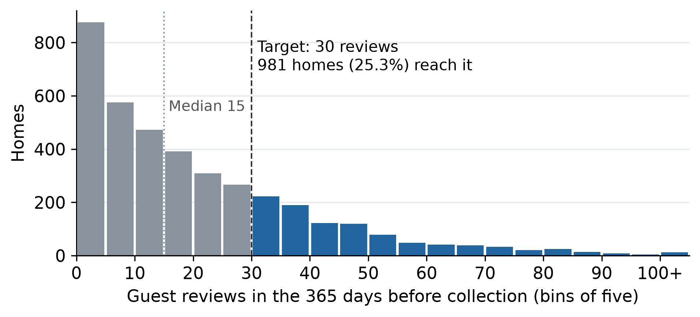
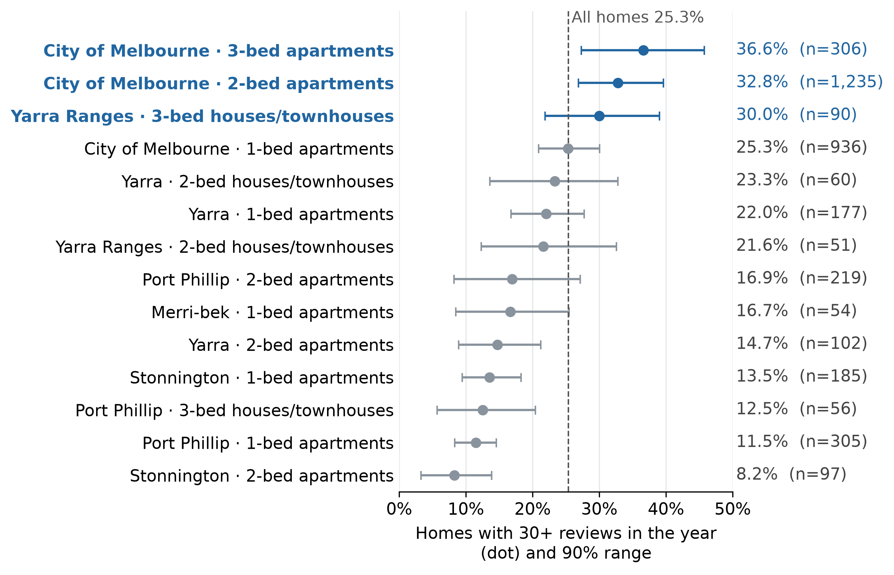
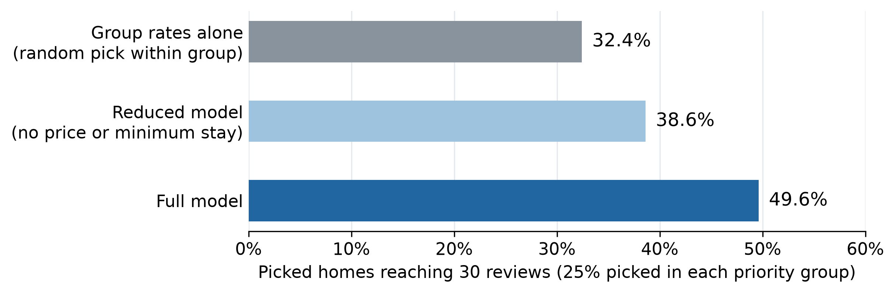
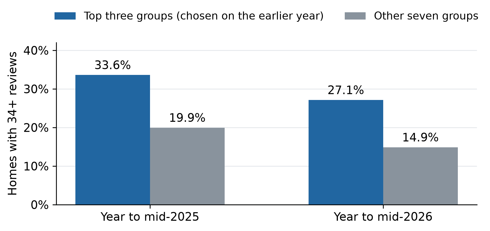
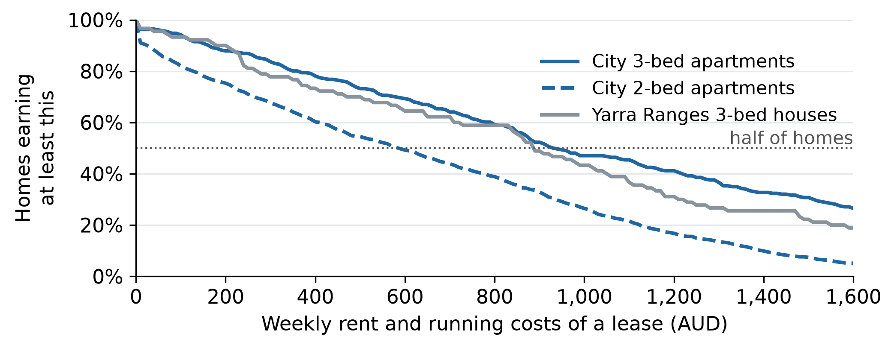

# Melbourne Airbnb Market Screening

CMCE30005 Final Project Report | Group 2 | Eric Huang and Maksym Xu

We help a rent-to-rent operator choose where to search and which homes to inspect. One Melbourne Airbnb snapshot identifies City two- and three-bedroom apartments as the first search priority, with Yarra Ranges three-bedroom houses as a less certain alternative. Within these groups, a simple model raises the historical screening hit rate from 32.4% to 49.6%.

**Final report (revised 19 October 2026):** [PDF](final-report/report-2026-10-04/Final_Report.pdf) · [Word](final-report/report-2026-10-04/Final_Report.docx) · [Markdown](final-report/report-2026-10-04/Final_Report.md) · [Report package and checks](final-report/report-2026-10-04/README.md)

After the report: [Repository guide](#repository-guide) · [How to reproduce the results](#how-to-reproduce-the-results) · [Contributions](#contributions)

<!-- final report starts here -->

## 1. Introduction

Our client plans to lease homes in Greater Melbourne for Airbnb short stays. Rent and setup costs come before guest income, so a poor lease ties up scarce startup funds.

We recommend City of Melbourne two- and three-bedroom apartments first, followed by Yarra Ranges three-bedroom houses and townhouses. These groups had the highest shares of homes with strong guest activity. Their typical homes brought in an estimated AUD 30,600–48,600 a year before costs, against AUD 24,700 across the study.

Within these groups, a simple model picks homes that reach our activity target about half the time (49.6%), against one in three (32.4%) at random. It ranks only homes already on Airbnb; for unlisted rentals, use the group order and the checks in Section 6.

## 2. Problem Definition and Objectives

The business question is: **where should a rent-to-rent operator with limited funds search, and which homes should it inspect first?** We set three objectives:

1. Rank property groups by the share of homes with strong guest activity, and translate this into estimated nights and revenue.
2. Test whether a simple model picks better homes within the leading groups than random picking.
3. Turn the results into a search order and a four-week inspection plan.

A **group** combines council area, dwelling type and bedroom count. A home is **busy** (reaches our target) when it receives at least 30 guest reviews in the 365 days before data collection, a level reached by a quarter of separate reference homes (Section 3). Inside Airbnb (n.d.) assumes half of stays are reviewed and each lasts three nights (or the minimum stay if longer), capping estimated nights at 70% of the year (255). With three-night stays, 30 reviews means about 180 booked nights a year.

We rank on reviews rather than revenue because Inside Airbnb's revenue estimate multiplies these nights by the advertised price, and without rents a higher price does not mean a better lease. Rents, costs and profit are outside our data.

Since the interim report, we replaced its random forest with an explainable logistic regression and added tests within the leading groups.

## 3. Data Description and Preparation

We use one Inside Airbnb snapshot of Melbourne, supplied through the subject LMS and collected 17 June–1 July 2026 (Inside Airbnb, 2026). It holds 25,728 listings with 90 fields and 1,026,690 dated reviews. We did not use the calendar, which cannot separate bookings from blocked nights.

Cleaning converted price text to numbers, standardized missing entries and counted amenities. We rebuilt annual review counts from review dates over the exact 365 days before collection; the supplied count covers 366 days. Price is missing for 6,553 listings (25%) and bedrooms for 4,679 (18%); 4,477 listings (17%) have never been reviewed.

We keep prices of AUD 30–1,500, excluding unpriced listings and extreme prices. Eligible homes are entire rental units and condos (*apartments*) or entire homes and townhouses (*houses/townhouses*), with one to three bedrooms and a first review at least a year before collection. This provides a full year of recorded review history.

We set aside about one in five hosts from the eligible sample (1,342 homes) to set an independent target. Their 906 homes in the final groups set the threshold: a quarter received 30 or more reviews (Table 1).

**Table 1. From supplied listings to analysis sample**

| Step | Homes |
|---|---:|
| All listings | 25,728 |
| Entire homes with one to three bedrooms | 16,576 |
| Apartments, condos, houses and townhouses | 14,895 |
| Priced AUD 30–1,500 | 11,099 |
| First review at least a year before collection | 6,891 |
| After setting aside 1,342 reference-host homes | 5,549 |
| **Analysis sample: 14 groups with at least 50 homes** | **3,873** |
| Reference homes in these groups (from 1,342; target only) | 906 |

The 3,873 analysis homes belong to 1,726 hosts in six council areas. The price rule drops 3,796 residential listings (14,895 minus 11,099): 77.8% had no review in the past year, against 17.0% of those kept.

## 4. Methodology

**Group comparison.** We compare the share of busy homes in the 14 groups. To show how much a share could move by chance, we redraw hosts at random 1,000 times and report the middle 90% of results.

**Model.** Logistic regression combines six inputs into a score and converts it into a chance of being busy, from 0% to 100% (R Core Team, 2026). Table 2 lists the outcome and inputs.

**Table 2. Outcome and inputs of the model**

| Variable | Definition |
|---|---|
| **Outcome** | 1 if the home had at least 30 reviews in the year, otherwise 0 |
| Council area | One of six |
| Dwelling type | Apartment, or house/townhouse |
| Bedrooms | One, two or three |
| Price compared with similar homes | Nightly price relative to the group median, in steps of 10% |
| Accepts one-night stays | Minimum stay of one night (yes or no) |
| Amenity count | Amenities listed, in steps of ten |

We compare this **full model** with two simpler options. The **group rate**, a group's share of busy homes, scores all its homes equally; within a group, this is **random picking**. The **reduced model** drops price and minimum stay to show what they add.

**Assumptions.** Homes run by the same host can perform alike, so they stay together in every test. Each 10% price step and ten extra amenities receive a fixed weight in the score. Checks for overlapping inputs and curved relationships are in Appendix A.

**Testing.** Each of 50 tests builds the model from 70% of hosts and scores the unseen homes of the other 30%. In each priority group, each method picks a quarter of test homes, and we compare the share that were busy.

**Two-year check.** For 2,657 homes with two years of reviews in ten groups, we chose the top three groups in the earlier year and followed them into the later year (target 34 reviews, set from the earlier year's reference homes).

## 5. Analysis and Results

### 5.1 Data exploration: most homes are quiet, and busy homes accept one-night stays

Guest activity is very uneven (Figure 1). The median home received 15 reviews, a quarter (981 homes, 25.3%) received 30 or more, and 334 homes (8.6%) received none.

**Figure 1.** Annual reviews per home, 3,873 analysis homes. Source of all figures and tables: Inside Airbnb (2026); Group 2 analysis.

**Table 3. Busy homes compared with the rest**

| Characteristic | Busy (30+ reviews) | Below 30 | All homes |
|---|---:|---:|---:|
| Homes | 981 | 2,892 | 3,873 |
| Median nightly price (AUD) | 254 | 266 | 262 |
| Median amenity count | 44 | 43 | 43 |
| Accept one-night stays | 67.7% | 37.5% | 45.1% |
| Minimum stay seven nights or more | 0.0% | 5.7% | 4.3% |
| In the City of Melbourne | 76.9% | 59.6% | 64.0% |
| Median estimated nights booked (cap 255) | 255 | 60 | 96 |
| Median estimated revenue (AUD a year) | 58,400 | 16,600 | 24,700 |

Busy homes were slightly cheaper with similar amenity counts, but far more often accepted one-night stays and sat in the City of Melbourne. Their median estimated revenue was 3.5 times higher (AUD 58,400 versus 16,600), reflecting its review-based formula (Table 3).

### 5.2 Descriptive comparison: City apartments are the first search priority

Group rates range from 8.2% to 36.6% against 25.3% overall, and the three priority groups lead (Figure 2, Table 4).

**Figure 2.** Share of busy homes in all 14 groups, with 90% ranges from redrawing hosts; priority groups in blue.

**Table 4. Priority groups: median estimated nights and annual revenue (AUD)**

| Group | Homes | Share busy | Nights, all homes | Revenue, all homes | Revenue rank | Revenue, below 30 |
|---|---:|---:|---:|---:|---:|---:|
| City 3-bed apartments | 306 | 36.6% | 126 | 48,600 | 1 | 32,100 |
| City 2-bed apartments | 1,235 | 32.8% | 108 | 30,600 | 5 | 16,600 |
| Yarra Ranges 3-bed houses | 90 | 30.0% | 120 | 46,100 | 2 | 31,100 |
| All 14 groups | 3,873 | 25.3% | 96 | 24,700 | – | 16,600 |

The same three groups lead when the price rule or the review-history rule is removed. The two City groups are the most reliable, staying in the top three in 94% and 90% of 1,000 host redraws; Yarra Ranges houses did so in 64%, a less certain second option.

**When the rankings differ.** Table 4 compares *all-home* medians with revenue medians for homes below 30 reviews. Yarra Ranges houses rank second on revenue and City two-bedroom apartments fifth, mainly because the houses charge more a night (AUD 426 against 285). With rents unknown, activity guides the search and revenue benchmarks test each lease (Recommendation 3).

### 5.3 Predictive screening: the model improves selection within the priority groups

Picking a quarter of each priority group, the full model found busy homes **49.6%** of the time, against **38.6%** for the reduced model and **32.4%** for random picking (Figure 3). That is five busy homes in ten, not three. Price and minimum stay carry most of this gain (+11.0 points).

**Figure 3.** Share of picked homes that were busy, averaged over 50 tests.

The full model beat random picking in **46 of the 50 tests**; in nine tests out of ten its gain lay between **−1 and +32 percentage points**. Within each group, the reduced model ranks by amenities alone. Its City three-bedroom hit rate was 33.9%, below random picking at 35.9%. We therefore use group priorities for unlisted rentals, where model performance remains untested.

The 49.6% result comes from picking within three priority groups over 50 tests. Table 5 instead pools predictions from five separate test groups, covering all 3,873 study homes, and picks one combined top-quarter list (969 homes). Its hit rate is 43.7% (precision), against 25.3% overall, and it finds 43.1% of busy homes (recall). Accuracy is 71.5%; calling every home "below target" scores 74.7% but finds none.

**Table 5. Full-sample confusion matrix: top quarter picked across all 14 study groups**

| Selection | Busy | Below target | Total |
|---|---:|---:|---:|
| Picked by model | 423 | 546 | 969 |
| Not picked | 558 | 2,346 | 2,904 |

For a typical City two-bedroom apartment, the model fitted to all study homes gives a **42% chance** of being busy with one-night stays and **18%** without. From 42%, ten more amenities give **48%**, while a 20% price premium gives **36%**. These examples explain the ranking; changing settings alone does not establish an increase in bookings. Table A1 reports model weights across the 50 training fits.

### 5.4 Prescriptive trade-off: inspection capacity sets list length

Shorter lists have a higher hit rate; longer lists find more busy homes (Table 6).

**Table 6. Inspection capacity within the priority groups (averages of 50 tests)**

| Homes inspected per group | Hit rate (precision) | Busy homes found (recall) | Gain over random picking (percentage points) |
|---|---:|---:|---:|
| 10% | 54.5% | 17.1% | +22.0 |
| 25% | 49.6% | 38.3% | +17.2 |
| 50% | 43.1% | 66.7% | +10.7 |

Inspecting 10% gives a 54.5% hit rate and finds 17.1% of busy homes; at 50%, the list finds two-thirds (66.7%). Start with ten candidates (Table 7), then inspect the highest-ranked listed homes as the budget allows.

### 5.5 Over time: the leading groups stayed ahead

The groups chosen for leading in the earlier year had 33.6% of homes reaching 34 reviews, against 19.9% elsewhere (Figure 4). In the later year, they still led: **27.1% against 14.9%**, about **12 percentage points**. The advantage also holds when hosts receive equal weight (Appendix A).

**Figure 4.** The same 2,657 surviving homes in two consecutive years; target 34 reviews.

## 6. Key Findings and Recommendations

### Key findings

1. **Where:** City of Melbourne two- and three-bedroom apartments had the highest shares of busy homes and above-median estimated revenue; Yarra Ranges three-bedroom houses follow but are less certain. All three stayed ahead a year later (Figures 2 and 4, Table 4).
2. **How homes are run:** Busy homes far more often accept one-night stays and charge slightly less than similar homes (Table 3, Section 5.3).
3. **Which home first:** Within the priority groups, the model raises the hit rate from one in three (32.4%) to one in two (49.6%) (Figure 3, Table 6).

### Recommendations

1. **Search City of Melbourne two- and three-bedroom apartments first, then Yarra Ranges three-bedroom houses.** Between leases that pass, choose the larger cash-flow margin; if margins are similar, choose the group with the higher share of busy homes.
2. **Order candidates already on Airbnb with the model.** For an unlisted rental, price near similar listings and trial one-night stays where allowed.
3. **Compare weekly rent and running costs with group revenue.** Typical weekly estimates (all-home medians) are **AUD 590** for City two-bedroom apartments, **930** for City three-bedroom apartments and **890** for Yarra Ranges houses; below-target medians are **320, 620 and 600**. Figure 5 shows how many historical homes covered a proposed cost. Drop candidates costing more than typical revenue, assess the rest through their own cash-flow plans, and budget for a year of the below-target shortfall. Obtain written landlord consent and check that any owners' corporation has not banned stays under 28 days (Consumer Affairs Victoria, n.d.). Airbnb collects Victoria's 7.5% short-stay levy on applicable bookings (State Revenue Office Victoria, n.d.).

**Table 7. Four-week inspection plan**

| Timing and owner | Action | Decision condition |
|---|---|---|
| **Week 1** (Operator) | Build a pool of ten candidates in the priority groups; rank listed homes within each group | Inspect top-ranked homes first, as time and budget allow; unlisted rentals follow the group order |
| **Weeks 2–3** (Operator & Analyst) | Confirm consent and building rules; negotiate rent; obtain cost quotes | Replace homes that fail any check |
| **Week 4** (Client) | Cash-flow plan: quotes against typical and below-target revenue (Recommendation 3, Figure 5) | Sign only if the plan covers setup costs and required return, and the buffer covers a year of below-target loss |
| **First 30 days** (Operator) | Record paid nights, stay length, workload and net cash flow alongside reviews | Expand only if results match the plan |

**Figure 5.** Share of each priority group's homes whose estimated weekly revenue reached a given weekly cost.

**Worked example (illustrative figures).** Weekly rent and quoted running costs total **AUD 620** for an unlisted City two-bedroom apartment and **AUD 700** for a Yarra Ranges three-bedroom house. The apartment exceeds its group's typical AUD 590 revenue, so it is dropped. The house clears its group's typical AUD 890 and advances to negotiation and its own cash-flow plan. At the below-target AUD 600 benchmark, it loses AUD 100 a week, requiring an AUD 5,200 annual buffer. The cash-flow plan must also recover setup costs and deliver the required return.

## 7. Limitations and Future Work

- **Reviews are not bookings or profit.** Inside Airbnb's 50% review rate sits within published estimates of 30.5%–72% (Inside Airbnb, n.d.), so dollar figures are rough, and activity fell in the later year (Figure 4).
- **One snapshot of surviving homes.** Homes that left Airbnb are missing, and revenue uses June–July prices. New entrants, unpriced listings and outer areas are not covered.
- **Short stays inflate reviews and revenue.** A one-night minimum allows more stays for the same nights booked, so part of its effect is built into the target; counting each stay as three nights may also overstate these homes' revenue.
- **Associations, not causes.** Settings were recorded at collection and may respond to earlier performance. Choosing the one-night input (after seeing no seven-night home reach 30 reviews) and selecting the priority groups on all homes mean the 50 tests may overstate the gain.
- **No rent, cost or regulation data.** Recommendation 3 relies on the client's own quotes.

Next, collect rent and cost quotes for the priority groups, track paid nights and net cash flow to check whether review activity identifies good businesses, and test the unchanged groups, model and selection rule on the next snapshot.

## 8. References

Consumer Affairs Victoria. (n.d.). *Making rules to ban short stay accommodation*. Retrieved October 16, 2026, from [https://www.consumer.vic.gov.au/housing/owners-corporations/rules/making-rules-to-ban-short-stay-accommodation](https://www.consumer.vic.gov.au/housing/owners-corporations/rules/making-rules-to-ban-short-stay-accommodation)

Huang, E., & Xu, M. (2026). *Melbourne Airbnb market screening* [Source code]. GitHub. [https://github.com/maksym-xu/CMCE30005-TheNextChapter/tree/final-report-marking-fixes-2026-10-16](https://github.com/maksym-xu/CMCE30005-TheNextChapter/tree/final-report-marking-fixes-2026-10-16)

Inside Airbnb. (n.d.). *Data assumptions*. Retrieved October 16, 2026, from [https://insideairbnb.com/data-assumptions/](https://insideairbnb.com/data-assumptions/)

Inside Airbnb. (2026). *Melbourne, Victoria, Australia: Listings and reviews* (June 2026 snapshot, via CMCE30005 LMS) [Data set]. [https://insideairbnb.com/get-the-data/](https://insideairbnb.com/get-the-data/)

R Core Team. (2026). *R: A language and environment for statistical computing* (Version 4.5.3) [Computer software]. R Foundation for Statistical Computing. [https://www.R-project.org/](https://www.R-project.org/)

State Revenue Office Victoria. (n.d.). *Understanding the short stay levy*. Retrieved October 16, 2026, from [https://www.sro.vic.gov.au/owning-property/short-stay-levy/understanding-short-stay-levy](https://www.sro.vic.gov.au/owning-property/short-stay-levy/understanding-short-stay-levy)

### AI acknowledgement

ChatGPT, Gemini and Claude Code assisted with writing and coding; Eric Huang and Maksym Xu reviewed the outputs.

### Author contributions

Maksym Xu led data preparation, modelling and validation; Eric Huang led report drafting and review. Earlier team contributions are recorded in the repository guide.

## Appendix A. Model Details

We fitted the model in R (R Core Team, 2026). Group median prices and mode fills for missing minimum stays use training homes only. The group rate is smoothed as `(group_successes + 10 * overall_rate) / (group_homes + 10)`. Odds are the chance of being busy divided by the chance of not being busy. Table A1 gives each input's odds ratio from its average coefficient over the 50 fits, and the range across fits; above 1 means a higher chance of being busy, below 1 a lower one.

**Table A1. Odds ratios across 50 fits**

| Input (compared with) | Odds ratio | Range across fits |
|---|---:|---:|
| Accepts one-night stays (no) | 3.27 | 2.53–4.05 |
| Ten more amenities | 1.27 | 1.15–1.41 |
| Price 10% above similar homes | 0.88 | 0.83–0.94 |
| **Council area (City of Melbourne)** | | |
| Port Phillip | 0.50 | 0.33–0.66 |
| Stonnington | 0.48 | 0.26–0.68 |
| Yarra | 0.83 | 0.59–1.11 |
| Yarra Ranges | 1.22 | 0.76–1.97 |
| Merri-bek | 0.75 | 0.36–1.19 |
| House or townhouse (apartment) | 0.78 | 0.57–1.30 |
| Two bedrooms (one) | 1.16 | 0.89–1.41 |
| Three bedrooms (one) | 1.31 | 0.86–1.84 |

Across the 50 tests on all 14 groups, the model ranked a random busy home above a random quiet one 71% of the time, against 60% for group rates (AUC 0.71 and 0.60); full evaluation tables are in the repository (Huang & Xu, 2026). Host-clustered standard errors are 1.1–2.6 times ordinary estimates, variance inflation factors sit below 3 (low multicollinearity), and host-adjusted tests find no clear curvature. In the two-year check (Section 5.5), equal host weights within each pool give an 8.7-point later-year gap (112 hosts appear in both pools).

<!-- final report ends here -->

---

## Repository guide

| Folder | What it holds |
|---|---|
| `final-report/report-2026-10-04/` | The final report (PDF, Word, Markdown), its five figures, the revision evidence script and outputs, and the scripts that build and check the report |
| `final-report/screening-followup-2026-10-03/` | The main model test: picking 25% of homes within each priority group (49.6% / 38.6% / 32.4%), plus 10% and 50% quotas |
| `final-report/paired-analysis-2026-10-02/` | The 50 repeated host splits comparing the model with group rates across all groups (AUC, Brier score, shortlist rates) |
| `final-presentation/` | The final presentation, its speaking script and its analysis package (the six-input logistic model, scenario chances, confusion counts) |
| `scripts/` | Data cleaning (`01`), sample and review target (`rq_scope_feasibility.py`), group ranking with host resampling (`08`), interim-stage models (`09`–`13`) and the two-year check (`validation/temporal_holdout.py`) |
| `reports/` | The interim report, interim-stage tables and figures, and supporting analyses |
| `config/review_analysis.json` | Eligibility rules, review-target design and random seed |
| `tests/` | Unit tests for cleaning, sample design and the group-rate baseline |

## How to reproduce the results

The three course CSV files (listings, reviews and calendar) are not published. Place them in `data/raw/` as `listings_airbnb.csv`, `reviews_airbnb.csv` and `calendar_airbnb.csv`. Software: R 4.5.3 with data.table, jsonlite, sandwich, ggplot2, scales, digest and stringr; Python 3.12 with the packages in `requirements-analysis.txt`, plus matplotlib, python-docx and pypdf for the report files. Run from the repository root:

1. `Rscript scripts/01_data_cleaning.R` (cleaned listings and review counts in `data/processed/`)
2. `python scripts/rq_scope_feasibility.py` (sample, reference hosts and the 30-review target)
3. `Rscript scripts/08_peer_ranking.R` (14 group rates with host-resampled ranges)
4. `python scripts/validation/temporal_holdout.py` (two-year check)
5. In `final-presentation/analysis/`: `mkdir -p private-inputs && Rscript scripts/prepare_private_input.R ../..`, then `sh run.sh` (six-input model)
6. In `final-report/paired-analysis-2026-10-02/`: copy `analysis_input.csv` and `../../final-presentation/analysis/working/oof_predictions_PRIVATE.csv` (renamed `legacy_oof_predictions_PRIVATE.csv`) into `private-inputs/`, then `bash run.sh`
7. In `final-report/screening-followup-2026-10-03/`: copy `analysis_input.csv` and the paired package's `working/test_predictions_PRIVATE.csv` and `working/split_membership_PRIVATE.csv` (prefixed `prior_`) into `private-inputs/`, then `bash run.sh`
8. Copy `analysis_input.csv` into `final-report/report-2026-10-04/private-inputs/`, then run `Rscript final-report/report-2026-10-04/scripts/revision_evidence.R`, `python final-report/report-2026-10-04/build_figures.py` and `python final-report/report-2026-10-04/scripts/build_report_docx.py`; export the PDF from Word; check with `python final-report/report-2026-10-04/scripts/check_report_package.py`

On 17 October 2026, all eight steps were re-run from the three course CSV files, whose SHA-256 fingerprints match those in `data/processed/cleaning_manifest.json`. Every committed number and figure was reproduced; the only differences were run dates, software version labels and rounding below 10⁻¹⁵ in the interim-stage random forest. All unit tests passed.

## Contributions

Maksym Xu led data preparation, modelling and validation; Eric Huang led report drafting and review.

Project history: Qihang Sun and Loc Le were members until the interim stage and co-authored the interim report and presentation; Qihang Sun also set up the repository and contributed early analysis. Earlier files keep the original four-member team details.
