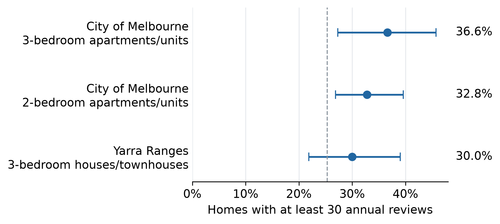
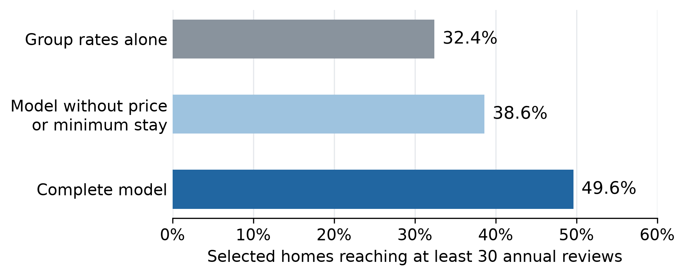
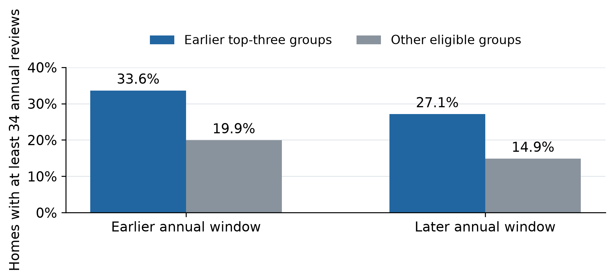
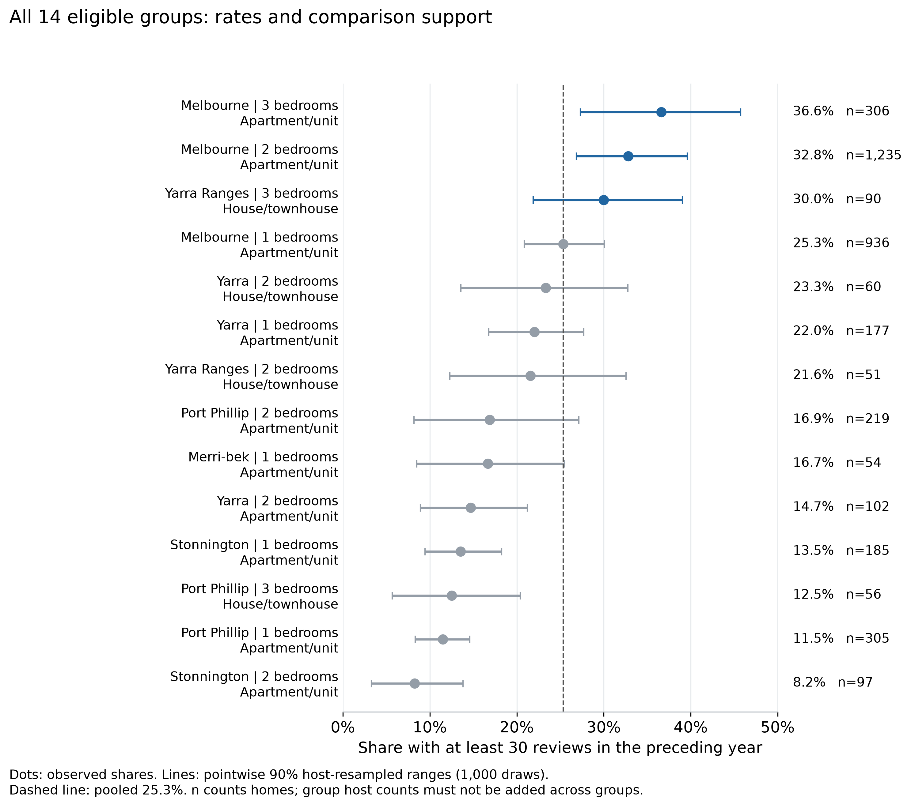

# Melbourne Airbnb Market Screening

CMCE30005 Final Project Report | Group 2

Eric Huang and Maksym Xu

## Current final report 14 October 2026

[Final report PDF](final-report/report-2026-10-04/Final_Report.pdf) · [Word](final-report/report-2026-10-04/Final_Report.docx) · [Matching report text](final-report/report-2026-10-04/Final_Report.md) · [Files and checks](final-report/report-2026-10-04/README.md)

The complete current report follows. It combines the current report wording with the listing benchmarks and saved coefficient summaries published in revision 4e2dd23. The model analysis remains pinned to revision e4c68ca. The report uses APA 7 references and a short AI acknowledgement. Models, headline results, charts and historical submissions are unchanged.

## 1. Introduction

Our client plans to lease homes in Greater Melbourne and offer short stays through Airbnb. Rent and setup costs commit scarce startup funds before guest income arrives. The first task is to focus the property search on council areas and home types with stronger evidence of guest activity.

We recommend starting with two- and three-bedroom apartments in the City of Melbourne. Three-bedroom houses and townhouses in Yarra Ranges provide a second search option. These three groups have the strongest historical review activity in our residential comparison.

We then test how to narrow the search within these priority groups. When selecting a quarter of homes in each group, a six-input logistic regression model produces lists where 49.6% reach at least 30 annual reviews, compared with 32.4% using group rates alone. This gives the client an evidence-based order for investigating established listings that already have comparable price, minimum-stay and amenity information. Lease permissions, quotes and cash flow determine which candidates to pursue.

## 2. Problem Definition and Objectives

The client needs to decide where to search and which properties to investigate first. We address two questions:

1. Which residential property groups have the strongest historical guest-review activity?
2. Within those priority groups, does property-level information improve selection beyond each group's historical rate?

A group combines council area, dwelling type and bedroom count. We compare entire apartments, houses and townhouses with one to three bedrooms and at least one year of recorded review history. A home reaches our target when it receives at least 30 dated reviews in the preceding 365 days. The target reflects the upper quarter (75th percentile) of a separate reference sample, giving every group the same benchmark.

The final analysis builds on the interim report with a simpler logistic regression model and 50 repeated host-level comparisons, including selection within the three priority groups. All analysis uses the Melbourne Inside Airbnb dataset supplied through the subject LMS.

## 3. Data Description and Preparation

The snapshot contains 25,728 listings collected between 17 June and 1 July 2026 (Inside Airbnb, 2026). We link property details to dated reviews and count reviews in the 365 days before each listing's collection date. Reviews record past guest activity, whereas calendar availability combines bookings and host-blocked dates, making reviews the clearer measure for this comparison.

Our residential scope includes four recorded property types: entire rental units and condos form the *apartment/unit* category; entire homes and townhouses form the *house/townhouse* category. We keep one to three bedrooms, quoted nightly prices of AUD 30–1,500 and a first review at least 365 days before collection. The price range removes unpriced listings and extreme outliers, while the 365-day rule ensures a full year of observable review history.

These rules leave 6,891 eligible homes. Before comparing groups or fitting models, we set aside 20% of hosts (1,342 homes) as a separate reference branch, leaving 80% of hosts (5,549 homes) for analysis. Retaining groups with at least 50 analysis homes leaves 3,873 analysis homes and 906 reference homes across the same 14 groups (Table 1).

**Table 1. From the supplied listings to the comparison sample**

| Sample stage | Listings |
|---|---:|
| Supplied snapshot covering all listing types | 25,728 |
| Entire homes with one to three bedrooms | 16,576 |
| Residential scope: rental units, condos, homes and townhouses | 14,895 |
| Eligible homes: nightly price AUD 30–1,500 and at least 365 days of review history | 6,891 |
| Analysis branch: homes after setting aside reference hosts (from 6,891) | 5,549 |
| Analysis branch: final homes in the 14 groups with at least 50 analysis homes each | 3,873 |
| Reference branch: separate hosts used only to set the review target (from 6,891) | 1,342 |
| Reference branch: reference homes within the same 14 groups | 906 |

The 3,873 analysis homes belong to 1,726 hosts across six council areas; about 64% are in the City of Melbourne. The median home has 15 annual reviews. We retain all 334 homes with zero annual reviews (8.6%) so the comparison includes quieter properties.

A separate check across the full snapshot finds 6,801 listings with missing or out-of-range prices. The supplied recent-review count is zero for 82.0% of these excluded listings, against 23.7% of listings retained by the price check. The price rule therefore shifts the sample towards more active properties, meaning our findings describe established, priced residential homes in the covered areas.

The 906 reference homes set our benchmark: their upper-quarter cutoff is 29.75 annual reviews, rounded up to 30. Reference hosts remain strictly separate from model training and testing.

## 4. Methodology

We first compare the share of homes reaching 30 annual reviews across the 14 eligible groups. Repeating the calculation across 1,000 resamples of hosts shows how much those shares vary. Each host's properties stay together because multi-listing hosts can share management practices.

We use binary logistic regression in R to rank individual homes. Its **outcome variable** is whether a home reaches at least 30 annual reviews. The **six independent variables (inputs)** are council area, dwelling type, bedroom count, nightly price relative to the median of similar training homes, acceptance of one-night stays, and amenity count. The model learns a weight for each input from training homes and combines their contributions into a score. Higher scores move homes earlier in the investigation list. Group median prices and replacements for three missing minimum-stay values are calculated strictly within each training sample (Appendix A).

Our **group-rate baseline** assigns every home its group's smoothed training target rate. Because all homes in one group receive equal baseline scores, selecting a fixed share within a single group using the baseline matches choosing homes at random within that group. A **reduced four-input model** removes price and minimum-stay information, ranking homes within a group by amenity count alone to show how much current operating details add to selection.

We compare the methods over 50 host splits (70% of hosts for training and 30% for testing, keeping each host's properties on the same side). The main comparison selects 25% of test homes separately within each priority group and averages the selected homes' target rates across the 50 tests. We also test 10% and 50% quotas to show how investigation capacity affects shortlist precision and coverage.

To check whether the search priorities hold across time, we reconstruct two consecutive 365-day review windows from the snapshot (the earlier 365-day window followed by the 365-day window ending on collection). Requiring at least two years of review history and at least 50 homes per group leaves 2,657 homes across ten groups. We follow the earlier leading groups into the later window using a fixed 34-review target set from the earlier reference window.

## 5. Analysis and Results

### 5.1 Descriptive comparison: City apartments are the first search priority

Across the analysis sample, 981 of 3,873 homes reach 30 annual reviews, or 25.3%. Group rates range from 8.2% to 36.6% across the 14 groups, giving the client a clear reason to focus the search.

City of Melbourne three-bedroom apartments lead at 36.6% (112 of 306 homes), followed by City of Melbourne two-bedroom apartments at 32.8% (405 of 1,235) and Yarra Ranges three-bedroom houses and townhouses at 30.0% (27 of 90). The city groups combine stronger observed activity with larger samples, supporting their position as the first search priority.

In the supplied snapshot, median quoted nightly prices are AUD 285, AUD 450 and AUD 425.75 for Melbourne two-bedroom apartments, Melbourne three-bedroom apartments and Yarra Ranges three-bedroom houses/townhouses, respectively. One-night acceptance ranges from 22.2% to 59.8%, and median amenity counts from 44 to 55. These are advertised rates, not rents or prices actually paid.

**Figure 1.** Homes reaching at least 30 annual reviews. Horizontal lines show 90% ranges from resampling hosts; the dashed line marks the overall 25.3%. Appendix B shows all 14 groups.

The same three groups lead when minimum group size changes to 30 or 75 homes, or when the price or history rule is removed. Their order can change across resamples, so use the three-group shortlist together to guide the search. Adding specialised accommodation alters the shortlist and addresses a broader market than the client's residential search.

### 5.2 Predictive screening: The model improves selection within the priority groups

The complete model helps decide which homes to investigate first. Selecting 25% within each priority group produces an average historical target rate of **49.6%**, compared with **38.6%** for the reduced model without price and minimum stay and **32.4%** for group rates alone (Figure 2).

The complete model adds **17.2 percentage points** over group rates alone. For a list of 100 selected homes, that means about **17 more homes** with at least 30 annual reviews, directing investigation time towards homes with stronger recorded guest activity.

**Figure 2.** Average historical target rates over 50 tests. Each method selects 25% within each priority group. The reduced model leaves out price and minimum-stay information.

The complete model leads in **46 of the 50 tests** and trails in four, with the middle 90% of gains running from **-0.7 to 31.8 percentage points**. These overlapping historical tests support prioritising investigations while showing how much performance varies with the homes available.

Across all 50 fits, holding property group fixed, **lower relative nightly prices, acceptance of one-night stays, and more amenities each raise a home's predicted score**. Together, price and minimum-stay information add 11.0 percentage points over the reduced model (49.6% versus 38.6%).

Without price and minimum-stay inputs, the reduced model ranks homes within a fixed group using amenity count alone—and in city three-bedroom apartments, its 33.9% target rate falls below the baseline's 35.9%. Because unleased new rentals do not yet have established Airbnb prices or stay rules, the reduced model is not a reliable substitute. Use the full six-input model to rank established listings with comparable operating details, and start new rental searches with the group priorities.

### 5.3 Prescriptive trade-off: Investigation capacity determines list size and coverage

Shorter lists concentrate on stronger historical activity, whereas longer lists capture more qualifying homes. Table 2 shows the choice available to a client with limited investigation time.

**Table 2. Results at different investigation capacities (50-split averages)**

| Share investigated in each group | Share of selected homes reaching 30 reviews | Share of all qualifying homes found | Gain over group rates (percentage points) |
|---|---:|---:|---:|
| 10% | 54.5% | 17.1% | +22.0 |
| 25% | 49.6% | 38.3% | +17.2 |
| 50% | 43.1% | 66.7% | +10.7 |

Investigating 10% gives a list where more than half (54.5%) reach the target, while capturing 17.1% of all qualifying homes. At 50%, the list captures two-thirds (66.7%) while beating group rates by 10.7 percentage points.

The 25% result is a reference for allocating investigation effort. Our proposed first round starts with ten available candidates from the priority groups, checked in priority order and expanded when permissions or cost quotes eliminate candidates.

### 5.4 Temporal stability: Earlier leading groups retain their advantage

The two-year comparison tracks the 2,657 homes across ten groups that have two full years of review history. In the earlier year, 33.6% of homes in the top three groups reached the 34-review target, compared with 19.9% in the other seven groups (Figure 3).

**Figure 3.** The same 2,657 homes compared in both years. The earlier leading groups remain ahead, although their qualifying share falls from 33.6% to 27.1%.

In the later year, 27.1% of homes in the earlier leading three groups reach the fixed 34-review target, compared with 14.9% in the other seven groups—an advantage of **12.3 percentage points** (from unrounded rates). Retaining this relative advantage as overall activity falls supports keeping them as search priorities while assessing current demand for each candidate property.

## 6. Key Findings and Recommendations

1. **Where to search first:** Search City of Melbourne two- and three-bedroom apartments first (32.8% and 36.6% target rates). Use Yarra Ranges three-bedroom houses and townhouses (30.0%) as an alternative when city lease terms or availability are unsuitable.
2. **How to rank candidates:** For established homes, collect comparable nightly prices, minimum-stay rules and amenity information, then use the complete model to order investigations. For unleased new rentals, use group priorities and compare permissions, rent and operating costs directly; scores based on proposed settings are scenario estimates that need a prospective test.
3. **What to verify before signing:** Obtain written confirmation of permitted short-stay use and quotes for rent, setup and operating costs. Estimate cash flow under expected and weaker-demand conditions, and choose a property that meets return and cash-buffer requirements under both conditions.

**Table 3. Proposed four-week first investigation round**

| Timing and owner | Action | Decision condition |
|---|---|---|
| **Week 1** (Operator) | Find ten available candidates in the priority groups and order established homes using the six-input model | Use group priorities alone for new rentals |
| **Weeks 2–3** (Operator & Analyst) | Confirm short-stay permissions, obtain cost quotes and assess current guest demand | Keep incomplete cases pending; replace homes that fail requirements |
| **Week 4** (Client) | Compare qualified homes using expected and weaker-demand cash flows | Select a home that meets return and cash-buffer requirements in both scenarios |
| **Operating trial** (Operator) | Record paid nights, stay length, workload and net cash flow alongside reviews over 30 days | Review actual performance before expanding; use group rates alone if model ranking adds little trial value |

## 7. Limitations and Future Work

Reviews measure recorded guest activity, whereas paid nights, stay length and costs determine profit. The operating trial should collect these measures alongside reviews to connect our search priorities to financial performance.

The sample covers established, priced homes in six council areas. The first-review rule establishes the length of the review record rather than continuous operation, and excluding unpriced listings removes a largely quiet segment (82.0% zero recent reviews). Removing price as a model input still uses this price-filtered sample. Future coverage tests should include new entrants, outer areas and unpriced listings.

Price and minimum-stay settings were recorded at collection and may reflect how hosts adjusted to earlier performance. Because these historical associations do not prove causal impacts, test planned changes prospectively during operations.

For the next validation, fix the search groups, model weights and selection rule before collecting new outcomes. This creates a fresh test beyond the overlapping historical comparisons and earlier exploration. Check whether model scores match observed rates before using them as individual probabilities.

## 8. References

Inside Airbnb. (2026). *Melbourne listings and dated reviews* (CMCE30005 LMS snapshot) [Data set]. [https://insideairbnb.com/get-the-data/](https://insideairbnb.com/get-the-data/)

### AI acknowledgement

ChatGPT, Gemini and Claude Code assisted with writing and coding; Eric Huang and Maksym Xu reviewed the outputs.

### Author contributions

Eric Huang and Maksym Xu jointly completed the analysis, validation and report preparation.

## Appendix A. Model Specification and Comparison Evidence

The complete model uses unpenalised logistic regression. Area, dwelling type, bedrooms and one-night acceptance are categorical factors, with Melbourne, apartment/unit, one bedroom and no one-night acceptance as reference levels. Relative price is `(price / training_group_median - 1) * 10`, and amenities are divided by ten. Training modes fill three missing acceptance values, and the overall training median covers any unseen price group. The baseline score is `(group_positives + 10 * overall_positive_share) / (group_count + 10)`. The reduced model retains area, dwelling type, bedrooms and amenities and is refitted on each training set, converging without warnings in all 50 splits.

Across the 50 repeated training fits, mean log-odds weights are +1.183 for one-night acceptance (odds ratio 3.27), +0.237 per ten additional amenities (1.27), and -0.127 per price increase equal to 10% of the training-group median (0.88). All three directions persist in 50/50 fits. These odds ratios describe conditional historical associations, not probability changes or causal effects.

**Table A1. Separate evaluation designs at 25 percent capacity**

| Evaluation design | Complete model | Baseline | Gain in percentage points |
|---|---:|---:|---:|
| Pooled five-fold all eligible homes (3,873) | 43.65% | 28.07% | +15.58 |
| Mean of 50 allocations all eligible homes (3,873) | 43.42% | 31.96% | +11.46 |
| Mean of 50 allocations three priority groups in one pool | 48.91% | 32.37% | +16.54 |
| Mean of 50 allocations separate group quotas (main report) | 49.62% | 32.43% | +17.19 |

Table A1 reconciles four evaluation designs at a 25% quota. Row 1 reports the pooled five-fold cross-validation across all 3,873 homes, where each home gets one held-out score; its 969 selections include 423 target-reaching homes and 546 below, leaving 558 qualifying homes outside the list. Rows 2–4 reuse the 50 host splits (70% training, 30% testing), computing precision within each split before averaging across splits: selecting 25% across all 14 groups (43.42%), pooling the three priority groups (48.91%), and selecting 25% separately within each priority group (49.62%, reported as 49.6% in Section 5.2). In every comparison, quotas round upward, methods select identical numbers of homes, and tied cutoff scores share boundary places equally without using outcomes.

Within separate 25% group quotas, complete-model gains average +16.37 percentage points in Melbourne two-bedroom apartments, +17.60 in Melbourne three-bedroom apartments and +24.99 in Yarra Ranges houses/townhouses. Reduced-model gains are +7.21, -2.05 and +19.35 points respectively. At 25%, the complete model captures 38.29% of qualifying homes, beating the reduced model in 42 splits and trailing in eight; the middle 90% of paired full-versus-baseline gains span -0.7 to 31.8 percentage points across the overlapping splits.

For all 3,873 eligible homes, mean AUC (ranking discrimination) is 0.7084 versus 0.6035, improving in all 50 splits. Mean Brier score (squared probability error) improves from 0.18406 to 0.17151, improving in 44 splits.

In the two-year comparison of 2,657 homes across ten groups, the later-year gap is 12.3 percentage points using unrounded rates, with a conditional 95% host-resample range of 5.1–20.1 points holding the earlier top three groups fixed, and 5.4–20.2 points when reselecting the top three groups in each resample (the exact earlier top-three set returns in 51.5% of resamples). Price diagnostics in `reports/supporting/revenue-analysis.md` use the supplied summary count, whereas main results use reconstructed 365-day counts. Code and verification files are in `final-report/paired-analysis-2026-10-02` and `final-report/screening-followup-2026-10-03`.

## Appendix B. Full Group Comparison

**Figure B1.** All 14 eligible groups, listing counts (`n`) and pointwise 90% ranges from resampling hosts. The dashed line marks the overall 25.3% rate across all 3,873 analysis homes.
